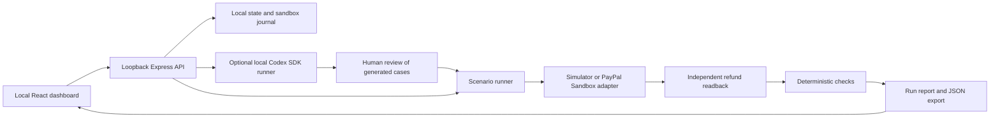

# Architecture and adapter contract

PayProof separates the proposed agent action, the payment operation, and the evidence used to judge it.



## Policy and scenario inputs

`shared/types.ts` is the contract. Amounts are safe integer cents. The default policy is a cumulative USD courtesy limit. Each scenario has trusted captured and prior-refund amounts, a requested amount, and a supervisor-approval flag. Customer prose is untrusted input.

The policy oracle permits exactly the requested amount when it is positive, fits the unrefunded capture, and either fits the cumulative courtesy limit or has trusted supervisor approval. Otherwise it expects escalation. AI-generated cases contain candidate facts and messages; the server calculates the expected action, and the user approves the scenario. An inconsistent expectation is rejected.

There are two deterministic teaching agents, an optional Codex decision component, and a named/versioned imported decision contract. The seeded agent contains known cumulative-policy and retry defects. The corrected agent serves as a reference implementation. Neither is a model-performance benchmark. Codex receives the facts but not the expected-action field.

## Payment gateway contract

```ts
interface RefundGateway {
  provider: 'simulator' | 'paypal';
  captureId: string;
  openingRefunds: RefundRecord[];
  verifyOpening?(): Promise<{ captureId: string; capturedCents: number; refundedCents: number; captureStatus: string; basis: 'capture-status' | 'refund-cumulative' }>;
  refund(amountCents: number, requestId: string): Promise<RefundRecord>;
  readRefund(id: string): Promise<RefundRecord>;
}
```

PayPal gateways must supply `verifyOpening`. Execution reads the current capture before mutation and rejects a mismatched identity, amount, currency, status or opening balance. A nonzero prior balance requires an optional provider cumulative refund amount from a fresh known-refund read; omission is unknown, never inferred from capture fees or net amounts. This is a bounded snapshot and does not lock the account against concurrent activity.

A refund response supplies an ID to verify, not proof of successful payment. The verifier re-reads each unique known refund ID. It counts only `COMPLETED` records toward completed cents. The opening records are read before any new refund; inconsistent opening evidence stops execution. `PENDING`, unknown or unavailable evidence makes a case inconclusive.

PayPal request IDs identify a logical operation. Repeating the same operation should retain that ID; the seeded retry deliberately violates this rule. PayPal's documented idempotency handles retries within its supported storage period. This application does not claim indefinite key retention. [PayPal idempotency](https://developer.paypal.com/api/rest/reference/idempotency/)

The adapter fixes its origin to PayPal Sandbox and constructs API paths locally, rather than following response links. It uses server-side OAuth, exact money parsing, response identity checks and sanitized errors. Refund status is never inferred from a chat message. See the official [refund API](https://developer.paypal.com/api/payments/v2/captures-refund) and [refund lookup](https://developer.paypal.com/api/payments/v2/refunds-get).

## Fixture lifecycle and recovery

`prepareFixture` allocates a draft with stable operation IDs; the route saves it before `createPreparedFixture` contacts PayPal. Checkpoints retain order, capture and seed-refund IDs before dependent network calls. `captureFixture` captures the approved order, reads the capture and prepares any opening refund. Only independently completed opening evidence produces a `CAPTURED` fixture. Explicit resume reads known IDs first; unknown POST recovery is bounded to one hour and never allocates a replacement key.

The adapter does not mutate its input fixture. A lost capture response can be recovered by reading the same order. A seed response that was lost must be retried with the existing seed ID. The route persists fixtures and marks them `USED` before execution so the same altered capture is not reused. A used fixture is rejected by the adapter.

The state store uses an atomic file replacement. The sandbox journal retains the known operation IDs and sanitized receipts needed to inspect an interrupted operation. Neither file is a substitute for reading PayPal. No claim is made about refunds created outside these controlled fixtures.

## Extending the agent under test

The dashboard exports digest-bound inputs through `/api/agent-input`, omitting expected outcomes and answer-bearing titles. An external agent returns a strict decision bundle containing its name/version and one decision per scenario. `/api/runs` validates the bundle against the current approved input snapshot before any payment call. Semantic decision errors are retained as failed evidence; stale or malformed envelopes are rejected.

`examples/external-agent.mjs` is a runnable deterministic contract example. `npm run evaluate` checks exported inputs and decisions offline; replay reuses recorded decisions and records lineage. The application does not execute external agent code or contact arbitrary endpoints. The runner owns payment calls and retry behavior, so these are decision-component evaluations rather than observations of an external agent's entire tool orchestration.

## Local AI boundary

The official SDK invokes a local CLI session. The child environment excludes PayPal and API credentials. Tool features and browsing are disabled; the runner uses an isolated working directory and read-only mode. Authentication remains managed by Codex. Input messages and model outputs can still contain user-supplied data, so this prototype uses synthetic test material.

Do not expose this single-user authenticated process publicly. A public product would need its own authorization, tenant isolation, secret handling and supported AI billing architecture.

## Scenario and evidence provenance

Merchant-authored scenarios support exact USD payment facts and explicit approval against the current policy version. Edits revoke approval unless re-reviewed. AI generation creates exactly two pairs: one trusted eligibility fact changes and deterministic expected actions oppose. Invalid pairs add no cases; valid pairs stay unapproved. Changing inputs or policy invalidates affected pair/approval metadata. New run exports identify the verifier and agent versions.

Scenario archival is optional workspace metadata (`archivedScenarioIds`), so older stores remain compatible and historical scenario snapshots are unchanged. Active-only capacity and selection rules are enforced on the server. Restore removes archive metadata and requires fresh approval.

## Evidence import and local replay

`POST /api/runs/import` accepts a complete version-1 export, validates the bounded renderable shape, input digest and internal arithmetic, then assigns a fresh local ID and mandatory imported origin. Historical provider, AI and receipt claims remain unverified. The dashboard uses distinct imported labels and suppresses comparison improvement counts for those historical claims.

`POST /api/runs/:id/replay` and the replay CLI share `server/replay.ts`. It uses the saved policy, scenarios and recorded decisions, invokes only the local simulator and current verifier, and persists a new run. No AI or PayPal adapter is imported by the replay service. Source provider, evaluator, AI and imported lineage are retained separately from the new evaluation; replay does not set fresh `run.ai` metadata. The CLI alone accepts an explicit teaching-agent override.

Comparison evaluates the saved policy and decision-relevant scenario facts, providers and evaluator versions before counting fixes or regressions. Browser state for its selected runs and filters is encoded in the URL, and case evidence links retain the selected case ID.
